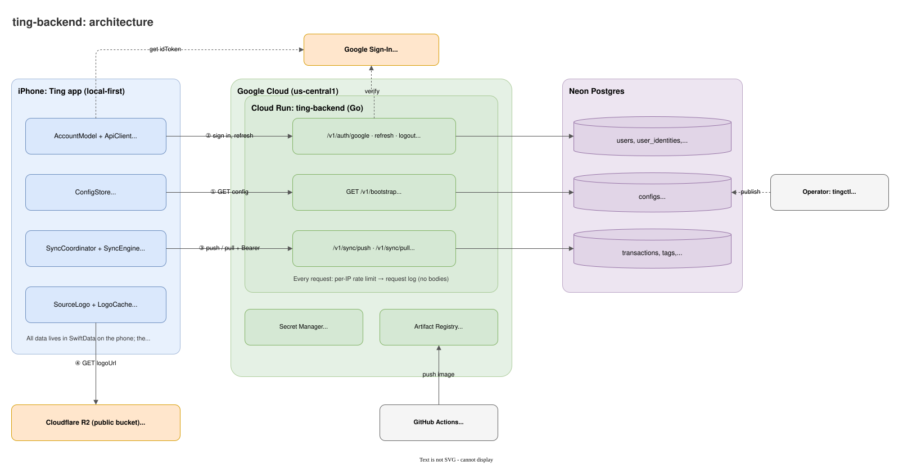
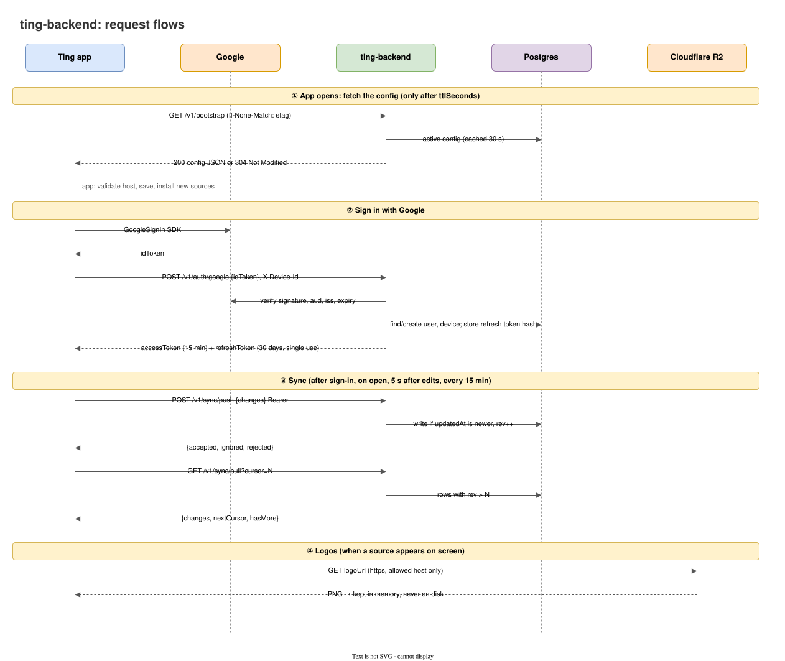
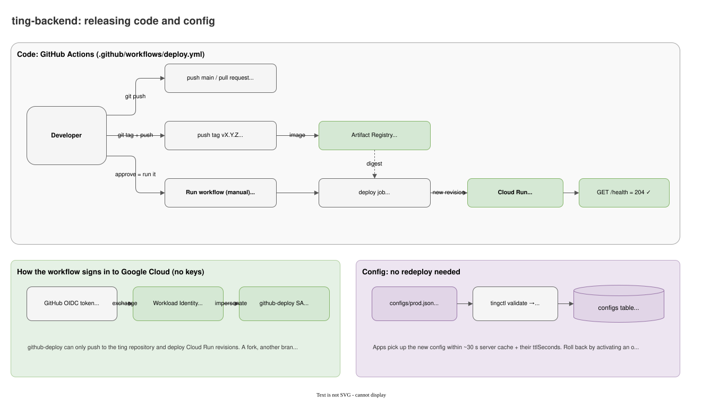

# ting-backend

The optional server behind the [Ting](https://github.com/mthangit/tingting) iOS app. The app works fully offline; this
backend adds **remote config**, **Google sign-in** and **backup and sync** across devices.

Go · Google Cloud Run · Neon Postgres · Cloudflare R2 · GitHub Actions

## Architecture



| Part | Role |
|---|---|
| **Ting app** | Local-first: everything is stored in SwiftData on the phone. It knows one URL (bootstrap) and gets everything else from the config |
| **Cloud Run: ting-backend** | One stateless Go service with three groups of APIs: bootstrap, auth and sync. Scales to zero |
| **Neon Postgres** | Versioned configs, users and refresh tokens (hashed), and each user's synced data |
| **Google Sign-In** | The app gets an `idToken`; the server verifies it with Google's public keys |
| **Cloudflare R2** | Bank and wallet logos. The app loads them directly, never through the server |
| **GitHub Actions + tingctl** | Code ships by tag + manual deploy; config ships separately with `tingctl`, no redeploy |

## How it works



1. **Config.** On launch the app asks `GET /v1/bootstrap` for the active config (with an ETag, so it's usually a
   `304`). The config lists the API endpoints by name, feature flags, sync timing and the bank/wallet catalog.
   A missing endpoint means that feature is off, so the server can turn features on and off without an app release.
2. **Sign-in.** The app sends Google's `idToken` to `POST /v1/auth/google`. The server verifies it, then issues a
   15-minute access token (JWT) and a 30-day refresh token that works only once and is rotated on every refresh.
3. **Sync.** `POST /v1/sync/push` stores a record only if its `updatedAt` is newer (last write wins), and bumps a
   per-user `rev` counter. `GET /v1/sync/pull?cursor=N` returns everything changed after `N`. Raw bank notification
   text stays on the phone by default.
4. **Logos.** Catalog entries point to logos on R2. The app downloads them when needed and keeps them in memory only.

## Releasing



```bash
git tag v0.4.0 && git push origin v0.4.0     # tests, then builds the image into Artifact Registry
```

Then deploy it: GitHub → **Actions** → **deploy** → **Run workflow** → pick the tag `v0.4.0` under *Use workflow
from* and leave `version` empty (or keep `main` and type `v0.4.0`). Pushes to `main` and pull
requests only run the tests. GitHub Actions signs in to Google Cloud with Workload Identity Federation, so there are
no keys stored anywhere.

Config changes don't need a deploy. The production config holds your real domain and bucket, so it isn't committed:
copy `configs/prod.example.json` to `configs/prod.json` (git-ignored) and fill it in.

```bash
go run ./cmd/tingctl validate configs/prod.json
go run ./cmd/tingctl publish configs/prod.json "what changed"   # needs DATABASE_URL
go run ./cmd/tingctl activate <version>
```

## Quick start

```bash
cp .env.example .env        # serves configs/local.json, no database needed
make run
curl -i http://localhost:8080/v1/bootstrap
```

Sign-in and sync need Postgres (`DATABASE_URL`) and a Google OAuth client ID (`TING_GOOGLE_CLIENT_IDS`). Tables are
created on startup.

```bash
go test ./...
```

## Project layout

| Path | Contents |
|---|---|
| `cmd/server` | The HTTP server |
| `cmd/tingctl` | Config CLI: validate, publish, activate, list |
| `internal/bootstrap` | `GET /v1/bootstrap` |
| `internal/auth` | Google sign-in, access and refresh tokens, auth middleware |
| `internal/datasync` | Sync push and pull |
| `internal/config` | Config validation, storage and cache |
| `internal/httpx` | Errors, request logging, rate limiting |
| `internal/db/migrations` | SQL schema |
| `configs/` | Local and production configs |
| `assets/logos/` | Source files for the logos on R2 |

## More docs

- [docs/OPERATIONS.md](docs/OPERATIONS.md): full API reference, publishing config and the bank catalog, R2 logos,
  deploy pipeline, one-time Google Cloud and GitHub setup, environment variables.
- [docs/DESIGN.md](docs/DESIGN.md): design goals, data model, security, trade-offs and roadmap.
- `docs/diagrams/*.drawio.svg` open and edit in [draw.io](https://app.diagrams.net) or the VS Code Draw.io extension.

## License

Released under the [MIT License](LICENSE). Bank and e-wallet logos in `assets/logos/` are trademarks of their owners
and are only used to identify money sources; they are not covered by the MIT License.
